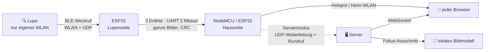

<p align="center">
  
</p>

<h1 align="center">Platinenlupe</h1>

<p align="center">
  <b>Aus einer günstigen WLAN-Ohrkamera wird ein Platinenmikroskop – ohne App.</b><br>
  Live in jedem Browser. Im eigenen Hotspot, im Heimnetz oder mit lokaler KI, die das Bauteil unter der Linse benennt.<br>
  Keine App. Keine Cloud. Kein Konto. Zwei ESP-Boards und drei Drähte.
</p>

<p align="center">
  <a href="LICENSE"></a>
  <a href="enclosure/LICENSE"></a>
  
  
  <a href="README.md"></a>
</p>

<p align="center">
  
</p>

---

## Worum es geht

Diese stiftförmigen WLAN-„Otoskope“ sind heimlich **großartige Lupen für Elektronik**: scharf auf wenige Millimeter,
heller LED-Ring, mit Akku, so groß wie ein Textmarker. Den Aufdruck eines 0402-Widerstands lesen, eine Lötstelle unter
einem QFN prüfen, den Punkt auf einem SOT-23 finden – alles da.

Nur ein Haken: Sie spricht **nur mit einer Handy-App**. Noch eine App mit Berechtigungen, kein Bild auf dem Laptop
oder dem Werkstattmonitor, nichts zum Zeigen für die Person nebenan.

**Platinenlupe** befreit sie:

- 🌐 **Nur der Browser.** Handy, Tablet, Laptop, der alte Monitor an der Werkbank – alles mit Browser.
- 🏠 **Lokal aus Prinzip.** Das Bild verlässt nie den Raum. Internet braucht es nie, nicht einmal zur Einrichtung.
- 🛠️ **Selbst verwaltet.** Deine Hardware, deine Firmware, deine Einstellungsseite, dein Server, dein Modell.
- 📡 **Geht ganz ohne Netzwerk.** Der Standardmodus spannt einen eigenen kleinen Hotspot auf. Verbinden – die Lupe ist da.
- 🔍 **Lokale KI, wenn du willst.** Bauteil antippen, und ein Bildmodell auf *deinem* Rechner sagt, was es ist.

## Drei Modi

<p align="center"></p>

| Modus | Du brauchst | Öffnen |
|---|---|---|
| **Hotspot** *(Standard)* | USB-Strom. Sonst nichts. | mit `Platinenlupe-XXXX` verbinden → die Seite öffnet sich von selbst |
| **Heimnetz** | dein WLAN | `http://platinenlupe.local` |
| **Server** | einen Docker-Rechner oder Raspberry Pi + ein lokales Bildmodell | `http://<server>:8080` |

Umgeschaltet wird auf der Einstellungsseite des Geräts. Jeder Modus enthält die volle Ansicht; der Server ergänzt nur
die Bauteil-Bestimmung. Einzelheiten: [docs/modes.md](docs/modes.md).

## Was sie kann

| | |
|---|---|
| **Livebild** | ~5 Bilder/s über einen NodeMCU (gemessen; die Kamera selbst liefert ~16), ohne Plug-in, ohne App |
| **Gerade halten** | der Lagesensor der Lupe hält das Bild aufrecht; die Ansicht wird ein rundes Bullauge, damit sich keine Ecken drehen |
| **Lichtring** | 0–100 % von der Seite aus, bleibt auch nach einem Neustart der Lupe erhalten |
| **Spiegeln · Standbild · Zoom 1×/2×/4× · Foto speichern** | was man an der Werkbank wirklich braucht |
| **Bauteil im Fokus** *(Server)* | antippen → Widerstand / Kondensator / IC / SOT-23 / LED / Durchkontaktierung …, Bauform, Aufdruck, Wert, Sicherheit |
| **Zweisprachig** | Deutsch und Englisch, je nach Browser |
| **Einstellungen im Gerät** | Modus, WLAN, Hotspot-Passwort – Passwörter verlassen nie das Board |
| **Demo eingebaut** | `web/index.html` direkt öffnen: eine erfundene Platine, die ganze Oberfläche, keine Hardware |

<p align="center">
  
  &nbsp;
  
</p>

## Schnellstart

**1 · Teile besorgen** – die Lupe (eine WLAN-Ohrkamera für die App *EarVision*; ihr WLAN heißt `softish-XXXXXX`),
ein ESP32-DevKit, ein NodeMCU (oder ein zweiter ESP32), vier Dupont-Kabel. → [docs/hardware.md](docs/hardware.md)

**2 · Flashen** – mit dem [Browser-Flasher](flasher/) (Chrome/Edge, ein Klick je Board) oder mit PlatformIO:

```bash
cd firmware
pio run -e loupe_side -t upload          # ESP32
pio run -e home_side_esp8266 -t upload   # NodeMCU
```

**3 · Verkabeln**

```
ESP32 GPIO17 (TX2) ──► NodeMCU D7
ESP32 GPIO16 (RX2) ◄── NodeMCU D8
ESP32 GND          ─── NodeMCU G
ESP32 VIN          ◄── NodeMCU VU   (ein USB-Kabel am NodeMCU versorgt beide)
```

**4 · Schauen** – Lupe einschalten, mit dem WLAN `Platinenlupe-XXXX` verbinden (Passwort `platinenlupe`), die Seite
öffnet sich. Unter *Geräte-Einstellungen* das Passwort ändern.

Bauteil-Bestimmung gewünscht? → [server/](server/) – `docker compose up -d` und auf LM Studio oder Ollama zeigen.

## Wie es funktioniert



Die Lupe besteht auf **ihrem eigenen** WLAN und kann sich nicht in deins einbuchen – und ein Handy ist immer nur in
einem WLAN. Also lebt ein ESP32 in der Welt der Lupe: Er weckt die Kamera per Bluetooth, geht in ihr WLAN, sammelt
jedes Bild vollständig und schickt es über ein kurzes Kabel. Das zweite Board lebt in deiner Welt. Keines der beiden
braucht jemals Internet.

Das Protokoll stammt aus der App und der Kamera-Firmware und ist am Gerät nachgemessen:
[docs/protocol.md](docs/protocol.md) · die Geschichte dazu: [docs/reverse-engineering.md](docs/reverse-engineering.md)
(beide auf Englisch).

## Bauteil-Bestimmung

Ins Bild tippen setzt den Fokusring auf ein Bauteil. Der Server schneidet die Stelle aus und fragt ein **lokales**
Bildsprachmodell – LM Studio (nimmt das gerade geladene Bildmodell), Ollama oder einen OpenAI-kompatiblen Server.

| Modell (5 echte Bauteile) | Art richtig | Antwortzeit |
|---|---|---|
| Gemma 4 26B | 5 / 5 | ~5 s |
| Qwen 3.6 35B-A3B (Feinabstimmung) | 4 / 5 | 1–1,6 s |
| Gemma 4 E4B | 2 / 5 | 1,4 s |

Ehrlich gesagt: **Aufdrucke liest kein Modell verlässlich** – die Seite sagt das bei jedem Wert dazu.
Mehr: [docs/identification.md](docs/identification.md).

## Das Gehäuse

<p align="center"></p>

Eine „Atomzeit-Kapsel“ im Stil der 50er für die IKEA-Skådis-Lochwand: Bullauge mit Atom, Tempostreifen, Heckflosse,
ein kleiner Saturn – und ein Köcher für die Lupe. Beige mit braunen Akzenten, ~80 g PLA, ohne Stützen.
OpenSCAD-Quelle, STL und fertige 3MF: [enclosure/](enclosure/).

## Was geprüft ist

| | Stand |
|---|---|
| Protokoll an der echten Lupe (TXW810, Fw 125): ~16 B/s, 0 kaputte Bilder, Licht 0–100 %, 60 s ohne Aussetzer | ✅ gemessen |
| Server Ende zu Ende mit Simulator und 3 % Paketverlust: 0 kaputte Bilder | ✅ gemessen |
| Bauteil-Bestimmung an echten Lupenbildern | ✅ gemessen (Tabelle oben) |
| UART-Rahmen samt CRC-Fehlern und Wiederaufsetzen | ✅ Unit-Test |
| Alle drei Firmwares bauen (ESP32, ESP8266, ESP32 als Hausseite) | ✅ CI |
| Seite auf Handy und Desktop, Deutsch und Englisch, Gerät / Server / Demo | ✅ Headless-Browser |
| Hotspot-Modus am echten NodeMCU: WPA2-Hotspot, Captive-Portal-Umleitung, Seite 15/15 vollständig, Einstellungen, WLAN-Suche, Verbindung zum ESP32 | ✅ gemessen |
| Ganze Kette an echter Hardware im Hotspot-Modus: Lupe → ESP32 → NodeMCU → Browser, 4,8 B/s, 0 Aussetzer in 30 s; Neustarts der Lupe werden überbrückt | ✅ gemessen |
| Heimnetz- und Servermodus an der Hardware | ⏳ in Arbeit |
| Gedrucktes Gehäuse | ⏳ noch nicht gedruckt |

## Häufige Fragen

**Geht meine Lupe?** Heißt ihr WLAN `softish-XXXXXX` und gehört sie zur App *EarVision*, sehr wahrscheinlich.
Geprüft: Chip TXW810, Firmware 125 (steht auf der Seite unter *Lupe und Verbindung*). Bitte andere melden.

**Warum nicht ein Board?** Ein ESP hat einen WLAN-Funk, und die Lupe geht nie in ein fremdes Netz. ESP32 kosten ein paar Euro.

**Geht die Original-App weiter?** Ja – an der Lupe wird nichts verändert. Nur eins von beiden zur selben Zeit.

**Ist der Hotspot sicher?** WPA2 mit einem Passwort, das du setzt. Ändere das Standardpasswort – die Seite erinnert
dich, bis du es tust. Nichts davon ins Internet stellen. Siehe [SECURITY.md](SECURITY.md).

**Mein Laptop hat im Hotspot kein Internet mehr.** Das ist das Captive Portal: Im Hotspot zeigt jeder Name aufs
Board. Hotspot verlassen (oder den Heimnetz-Modus nutzen), dann ist das Internet wieder da.

**Braucht die Bestimmung eine Grafikkarte?** Sie braucht irgendwo im Netz ein Bildmodell. Ein Mac mit LM Studio oder
ein PC mit Ollama klappt gut; kleine Modelle antworten schnell, raten aber öfter.

## Dank

- [rbeilvert/otoscope](https://github.com/rbeilvert/otoscope) – der freie Viewer, der zeigte, dass diese Familie zu befreien ist.
- [ESP Web Tools](https://esphome.github.io/esp-web-tools/), [NimBLE-Arduino](https://github.com/h2zero/NimBLE-Arduino),
  [aiohttp](https://github.com/aio-libs/aiohttp), [Pillow](https://python-pillow.org), [OpenSCAD](https://openscad.org).

Keine Verbindung zu den Herstellern der Kamera oder der App EarVision. Marken gehören ihren Inhabern. Das Projekt dient
der Interoperabilität: Es verändert die Kamera nicht und enthält keinen Herstellercode.

## Lizenz

Code und Doku: [MIT](LICENSE). Gehäuse (`enclosure/`): [CC BY-SA 4.0](enclosure/LICENSE).

<p align="center"><sub>Gebaut an einer Werkbank, für Werkbänke. Wenn sie dir einen Aufdruck lesbar gemacht hat, den du vorher nicht lesen konntest – gib ihr einen ⭐.</sub></p>
