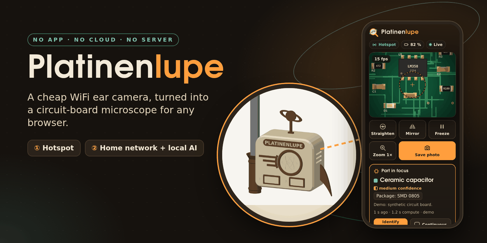
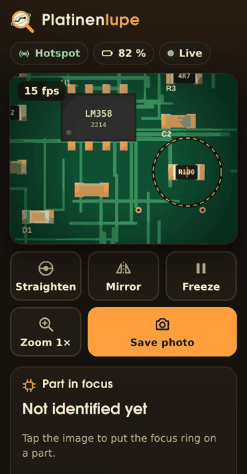
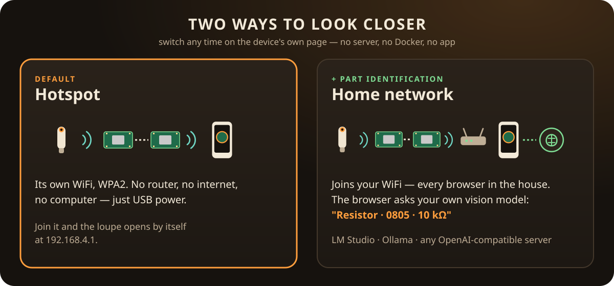
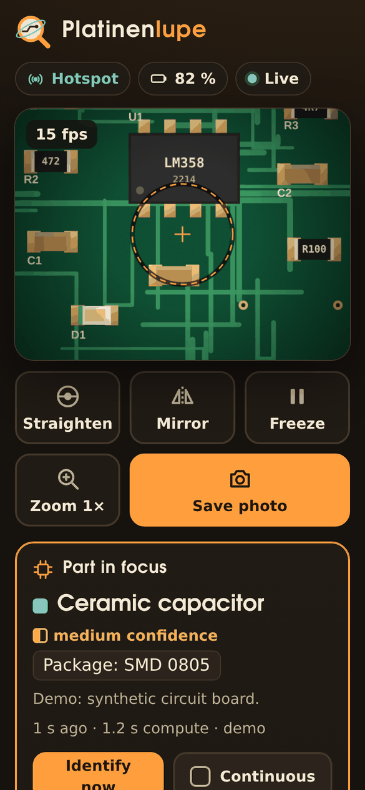
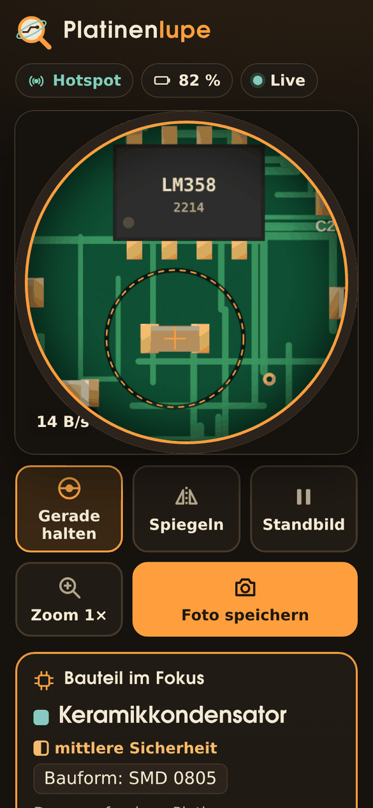
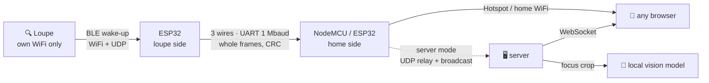

<p align="center">
  
</p>

<h1 align="center">Platinenlupe</h1>

<p align="center">
  <b>Turn a cheap WiFi ear camera into an app-free circuit-board microscope.</b><br>
  Live in any browser. On its own hotspot, in your home network, or with local AI that names the part under the lens.<br>
  No app. No cloud. No account. Two ESP boards and three wires.
</p>

<p align="center">
  <a href="LICENSE"></a>
  <a href="enclosure/LICENSE"></a>
  
  
  
  <a href="README.de.md"></a>
</p>

<p align="center">
  
</p>

---

## Why

Those pen-shaped WiFi "otoscopes" are secretly **brilliant loupes for electronics**: sharp at a few millimetres, a
bright LED ring, battery powered, about the size of a marker. Reading the marking on an 0402 resistor, checking a
solder joint under a QFN, finding the dot on a SOT-23 — it is all right there.

There is just one catch: it only talks to **a phone app**. One more app with permissions, no way to put the picture
on a laptop or a bench monitor, no way to show the person next to you.

**Platinenlupe** sets it free:

- 🌐 **Browser only.** Phone, tablet, laptop, the old monitor on the bench — anything with a browser.
- 🏠 **Local by design.** The image never leaves your room. No internet connection is ever needed, not even for setup.
- 🛠️ **Self-managed.** Your hardware, your firmware, your settings page, your server, your model.
- 📡 **Works with no network at all.** The default mode opens its own little hotspot. Join it — the loupe pops up.
- 🔍 **Optional local AI.** Tap a part and a vision model on *your* machine tells you what it is.

## Three modes

<p align="center"></p>

| Mode | You need | Open |
|---|---|---|
| **Hotspot** *(default)* | USB power. That's it. | join `Platinenlupe-XXXX` → the page opens by itself |
| **Home network** | your WiFi | the board's address, shown on its settings page (computers: `http://platinenlupe.local`) |
| **Server** | any Docker host or Raspberry Pi + a local vision model | `http://<server>:8080` |

Switch on the device's own settings page. Every mode includes the full viewer; the server only adds
identification. Details: [docs/modes.md](docs/modes.md).

## Features

| | |
|---|---|
| **Live view** | ~5 fps through a NodeMCU (measured; the camera itself delivers ~16), no plug-ins, no app |
| **Straighten** | the loupe's motion sensor keeps the picture upright; the view becomes a round porthole so nothing spins in the corners |
| **Light ring** | 0–100 % from the page, kept alive across restarts of the loupe |
| **Mirror · Freeze · Zoom 1×/2×/4× · Save photo** | the things you actually need at the bench |
| **Part in focus** *(server)* | tap → resistor / capacitor / IC / SOT-23 / LED / via …, package, marking, value, confidence |
| **Bilingual** | English and German, picked from your browser |
| **Settings on the device** | mode, WiFi, hotspot password — passwords never leave the board |
| **Demo built in** | open `web/index.html` from disk: a synthetic board, the full UI, no hardware |

<p align="center">
  
  &nbsp;
  
</p>

## Quick start

**1 · Get the parts** — the loupe (a WiFi ear camera made for the *EarVision* app; its WiFi is called
`softish-XXXXXX`), an ESP32 DevKit, a NodeMCU (or a second ESP32), four Dupont wires.
→ [docs/hardware.md](docs/hardware.md)

**2 · Flash** — with the [web flasher](flasher/) (Chrome/Edge, one click per board) or PlatformIO:

```bash
cd firmware
pio run -e loupe_side -t upload          # ESP32
pio run -e home_side_esp8266 -t upload   # NodeMCU
```

**3 · Wire**

```
ESP32 GPIO17 (TX2) ──► NodeMCU D7
ESP32 GPIO16 (RX2) ◄── NodeMCU D8
ESP32 GND          ─── NodeMCU G
ESP32 VIN          ◄── NodeMCU VU   (one USB cable on the NodeMCU powers both)
```

**4 · Look** — switch the loupe on, join WiFi `Platinenlupe-XXXX` (password `platinenlupe`), and the page opens.
Change the password under *Device settings*.

Want part identification? → [server/](server/) — `docker compose up -d` and point it at LM Studio or Ollama.

## How it works



The loupe insists on running **its own** WiFi and cannot join yours — and a phone can only be in one WiFi at a time.
So one ESP32 lives in the loupe's world: it wakes the camera over Bluetooth, joins its WiFi, collects every frame
completely and sends it over a short cable. The second board lives in yours. Neither board needs the internet,
ever.

The protocol was reverse-engineered from the app and the camera firmware and measured on the device:
[docs/protocol.md](docs/protocol.md) · the story: [docs/reverse-engineering.md](docs/reverse-engineering.md).

## Part identification

Tap the picture to drop the focus ring on a part. The server crops that spot and asks a **local** vision-language
model — LM Studio (uses whatever vision model is loaded), Ollama, or any OpenAI-compatible server.

| Model (5 real parts) | Part type right | Answer time |
|---|---|---|
| Gemma 4 26B | 5 / 5 | ~5 s |
| Qwen 3.6 35B-A3B fine-tune | 4 / 5 | 1–1.6 s |
| Gemma 4 E4B | 2 / 5 | 1.4 s |

Honest caveat: **no model reads markings reliably** — the page says so next to every value.
More: [docs/identification.md](docs/identification.md).

## The case

<p align="center"></p>

A 1950s "atomic age capsule" for an IKEA Skådis pegboard: porthole with an atom, speed stripes, a tail fin, a little
Saturn — and a quiver that holds the loupe. Beige with brown accents, ~80 g of PLA, no supports.
OpenSCAD source, STL and a ready 3MF: [enclosure/](enclosure/).

## What is tested

| | Status |
|---|---|
| Protocol on the real loupe (TXW810, fw 125): ~16 fps, 0 broken frames, light 0–100 %, 60 s without a gap | ✅ measured |
| Server end-to-end with the simulator and 3 % packet loss: 0 broken frames | ✅ measured |
| Part identification on real loupe images | ✅ measured (table above) |
| UART framing incl. CRC errors and resync | ✅ unit test |
| All three firmwares build (ESP32, ESP8266, ESP32 home side) | ✅ CI |
| Page on phone and desktop, English and German, device / server / demo | ✅ headless browser |
| Hotspot mode on a real NodeMCU: WPA2 hotspot, captive-portal redirect, page 15/15 complete, settings, WiFi scan, link to the ESP32 | ✅ measured |
| Whole chain on real hardware in hotspot mode: loupe → ESP32 → NodeMCU → browser, 4.8 fps, 0 misses in 30 s; loupe restarts are recovered | ✅ measured |
| Weak signal (loupe at −75 dBm): 3.4 fps steady for 3 min, 0 link errors (at 2 Mbaud it froze in a loop — now 1 Mbaud) | ✅ measured |
| Home-network and server mode on hardware | ⏳ in progress |
| Printed case | ⏳ not printed yet |

## Repository

```
firmware/    ESP32 loupe side, ESP8266/ESP32 home side (PlatformIO), UART framing + test
web/         the one page — device, server and demo; no dependencies, works offline
server/      optional Python server: discovery, WebSocket stream, identification, simulator
enclosure/   OpenSCAD case, build + collision check, STL/3MF        (CC BY-SA 4.0)
flasher/     browser flasher (ESP Web Tools)
docs/        modes, hardware, protocol, identification, reverse engineering
```

## FAQ

**Does my loupe work?** If its WiFi is called `softish-XXXXXX` and it is meant for the *EarVision* app, very likely.
Tested: chip TXW810, firmware 125 (shown on the page under *Loupe and connection*). Please report others.

**Why not one board?** One ESP has one WiFi radio, and the loupe never joins another network. ESP32s cost a few euros.

**Can I keep using the official app?** Yes — nothing on the loupe is changed. Use one or the other at a time.

**Is the hotspot secure?** WPA2 with a password you set. Change the default — the page nags until you do.
Don't expose any of this to the internet. See [SECURITY.md](SECURITY.md).

**My laptop loses the internet while it is in the hotspot.** That is the captive portal: inside the hotspot every
name resolves to the board. Leave the hotspot (or use home-network mode) to get the internet back.

**Does identification need a GPU?** It needs a vision model somewhere in your network. A Mac with LM Studio or a PC
with Ollama works well; small models answer fast but guess more.

## Credits

- [rbeilvert/otoscope](https://github.com/rbeilvert/otoscope) — the open viewer that proved this family can be freed.
- [ESP Web Tools](https://esphome.github.io/esp-web-tools/), [NimBLE-Arduino](https://github.com/h2zero/NimBLE-Arduino),
  [aiohttp](https://github.com/aio-libs/aiohttp), [Pillow](https://python-pillow.org), [OpenSCAD](https://openscad.org).

Not affiliated with the makers of the camera or the EarVision app. All trademarks belong to their owners. This
project exists for interoperability: it does not modify the camera and contains no vendor code.

## License

Code and docs: [MIT](LICENSE). Case design (`enclosure/`): [CC BY-SA 4.0](enclosure/LICENSE).

<p align="center"><sub>Made at a workbench, for workbenches. If it helped you read a marking you couldn't read before — give it a ⭐.</sub></p>
