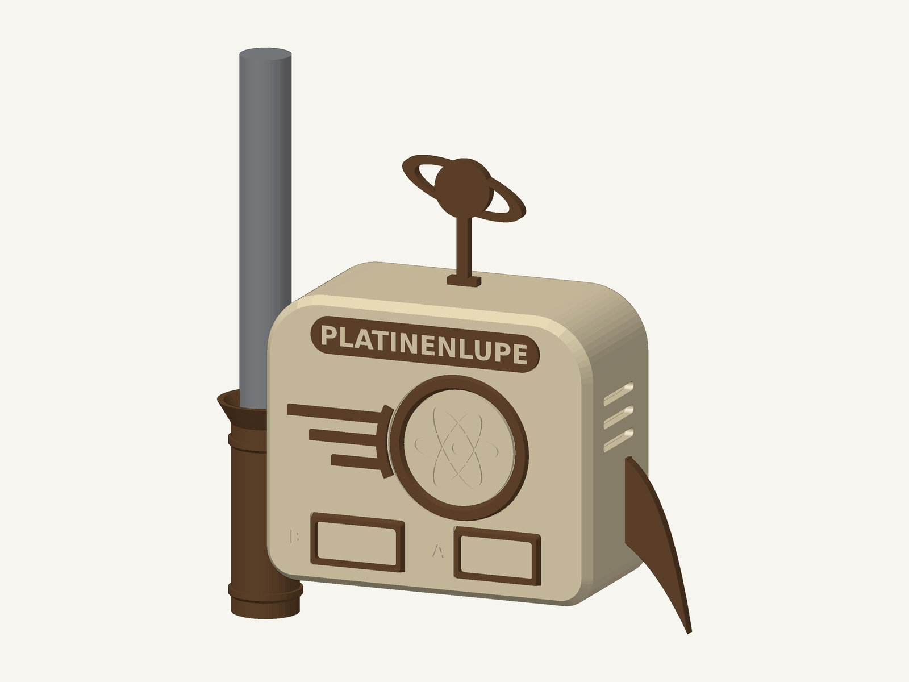
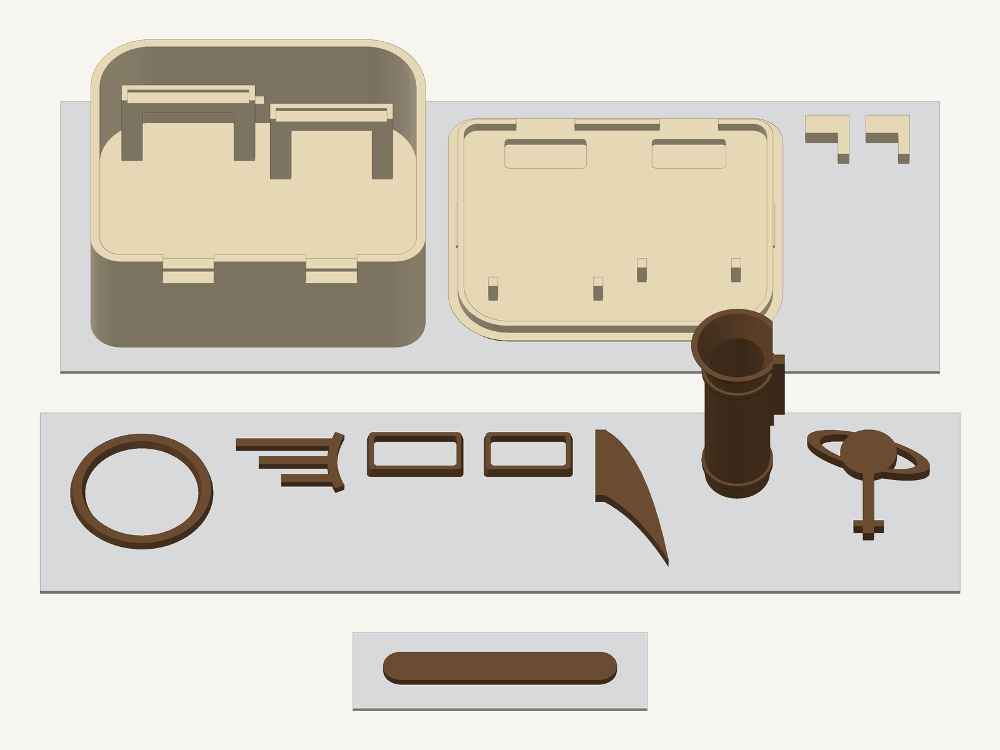

# Enclosure: the "atomic age capsule"



A 3D-printable case in 1950s retro-futurist style: porthole with an atom emblem, speed stripes,
tail fin, Saturn antenna and a silo-shaped quiver. It holds both boards of the Platinenlupe:

- **board A**: ESP32 DevKit V1 (30 pins), right side, marked "A"
- **board B**: NodeMCU v3 LoLin (ESP8266), left side, marked "B"

The quiver on the left holds the loupe pen. The whole case hangs on an **IKEA Skådis** pegboard.
Colours: beige body, brown accents. Every colour has its own print plate, so there is no filament
change except on the small two-colour name badge.

**No glue anywhere.** Every part clicks in: the boards latch into the body, the decorations into the
lid, fin, quiver, Saturn and hooks into the walls. A slider under the bottom opens only **one** USB
socket at a time, so two power supplies can never meet.

| File | Content |
|---|---|
| `platinenlupe_case.scad` | the model; all dimensions are parameters at the top |
| `lettering.py` → `lettering.scad` | letters as polygons (see [Pitfalls](#pitfalls)) |
| `check.scad` | dummies for both boards, plugs and pen; collisions as intersections |
| `build.py` | builds everything: lettering, STLs, mesh and collision checks, 3MF, test slice |
| `tools/bambu_3mf.py`, `tools/bambu_p1s_template.json` | 3MF writer for Bambu Studio, P1S/PLA settings (the template is AGPL-3.0, see `tools/NOTICE-bambu-template.md`) |
| `tools/render.py` | renders the pictures in `docs/images/` from the STLs |
| `print/` | ready-to-print STLs and `platinenlupe_case.3mf` |

## Build

```sh
pip install trimesh matplotlib numpy pillow
python build.py                 # STLs + checks + 3MF, then a test slice if Bambu Studio is found
python build.py --no-slice
python tools/render.py          # optional: README pictures
```

`build.py` writes intermediate files to `~/.cache/platinenlupe-enclosure` (`--work`) and copies the
printable STLs and the 3MF to `print/` (`--print-dir`). It aborts on **any** OpenSCAD warning, on a
mesh that is not watertight, on a wrong number of solids per part, and on any collision.

Tools are found like this (override with environment variables or `--openscad` / `--bambu-studio`):

| Variable | Default |
|---|---|
| `OPENSCAD` | `openscad` on `PATH`, else `flatpak run org.openscad.OpenSCAD`, else `flatpak-spawn --host flatpak run org.openscad.OpenSCAD` (when `build.py` itself runs inside a Flatpak, e.g. an IDE) |
| `BAMBU_STUDIO` | `bambu-studio` on `PATH`; if missing, the test slice is skipped with a message |

Example for an extracted Bambu Studio AppImage, started from inside a Flatpak sandbox:

```sh
BAMBU_STUDIO="flatpak-spawn --host $HOME/Apps/bambu-studio/squashfs-root/AppRun" python build.py
```

Sandboxed tools (Flatpak OpenSCAD, `flatpak-spawn --host`) usually see only your home directory.
Keep `--work` under `~`, not in `/tmp`.

## 1. Measure before printing (2 minutes, calipers)

The ESP32 board size comes from **one** source only. Please measure, enter any difference at the
top of `platinenlupe_case.scad`, and run `python build.py` again.
The PCB width matters more than before: the board latches sit 0.2 mm from the PCB edge, so a wrong
width makes them too tight or too loose.

| What | In the model | Confirmed |
|---|---|---|
| Loupe pen: diameter × length, cap length | 13.1 × 142.7 mm, cap 50 mm (`pen_d`, `pen_l`, `cap_l`) | ✅ measured 2026-10-27 |
| NodeMCU: PCB length × width | 58.0 × 31.0 mm (`nodemcu`) | ☐ |
| ESP32 30 pins: PCB length × width | 51.8 × 28.2 mm (`esp32`) | ☐ |
| PCB underside to the end of a Dupont socket | ≤ 25 mm (`cable_h`) | ☐ |
| Your USB-C plug including strain relief | ≤ 13.5 × 9 mm (`usb_w`, `usb_h`) | ☐ |
| Skådis board thickness | 5.2 mm (`pegboard_t` − 0.4) | ☐ |
| NodeMCU on USB: voltage VU to G (multimeter) | 5 V expected, **not confirmed** | ☐ |

## 2. Print (Bambu Lab, AMS: slot 1 beige, slot 2 brown)



Open `print/platinenlupe_case.3mf`. Three plates, **no supports**:

| Plate | Parts | Time | Filament |
|---|---|---|---|
| 1 Beige | body (back wall down), lid (face side down), 2 hooks | 2 h 02 min | 71.9 g |
| 2 Brown | porthole ring, speed stripes, 2 light frames, tail fin, Saturn, quiver (upright), USB slider | 37 min | 13.5 g |
| 3 Badge | name badge in brown with beige lettering inlaid (face side down, 2 filament changes) | 9 min | 2.6 g |

Sliced with the Bambu Studio CLI, P1S profile, 0.4 mm nozzle, PLA, 0.20 mm layers (2026-10-29).
The plain STLs in `print/` work in any slicer.

The two light bands (3–13 mm from the USB end, almost as wide as the PCB) let the board LEDs shine
through 0.6 mm of beige. The exact LED position is not measured; the band covers the usual area.

## 3. Assembly — everything clicks, nothing is glued

1. **Hooks**: push each one into its slot in the back wall from behind, leg pointing down, until it
   clicks. Two prongs catch behind the wall.
2. **Brown parts on the lid**: lay each one in its recess and press until it clicks. A small tongue at
   the edge springs back under the rim of the recess.
3. **Tail fin** into the slot on the right, **quiver** into the slot on the left, **Saturn** into the
   slot on top: push in until it clicks.
4. **USB slider**: with the lid off, slide it into the slot under the bottom from above, knob outwards
   and with the plate at the left end ("RUN"), until it clicks.
5. **Boards**: put them in from the front, USB socket down into the notch, and press each PCB onto its
   supports until the four latch arms click over its edge. The Dupont plugs underneath can no longer
   push it up — with or without the lid. To take a board out, bend the arms outwards a little.
6. **Wire** them (Dupont, female–female), then press the lid on. Its latches snap in, and four
   slightly springy hold-downs press on the boards as a second safety.

To take a part off again: fin, quiver, Saturn and hooks by squeezing their two prongs from inside;
the slider by pushing a pin through one of the small D-shaped holes and lifting it out.

### Wiring

| ESP32 (board A, right) | Wire | NodeMCU (board B, left) |
|---|---|---|
| GPIO 17 (TX2) | → | D7 (GPIO 13, RX after `Serial.swap()`) |
| GPIO 16 (RX2) | ← | D8 (GPIO 15, TX) |
| GND | — | G |
| VIN | ← | VU (5 V from the NodeMCU's USB) |

### Power rule and the USB slider

**One** USB cable, plugged into the **NodeMCU**, powers both boards: the ESP32 gets 5 V through
VU → VIN. The NodeMCU v3 LoLin has a **micro-USB** socket, most ESP32 DevKits a USB-C one; both fit the
notches.

- ⚠️ **Never connect two power supplies while VU–VIN is wired.** The case to avoid: a USB cable in
  the ESP32 while the NodeMCU's USB is powered too.
- The slider under the bottom makes that mechanically impossible. It has two click positions:

| Knob at | Open | Covered | For |
|---|---|---|---|
| **RUN** (left, default) | NodeMCU (B) | ESP32 (A) | normal use |
| **FLASH** (right) | ESP32 (A) | NodeMCU (B) | flashing the ESP32 |

  In every position in between, both openings are narrower than the metal shell of the plug that
  belongs there: USB-C at the ESP32, micro-USB (6.85 mm) at the NodeMCU — at worst a 2.9 mm gap.
- Flashing the NodeMCU: slider at RUN, as in normal use.

## 4. Mounting

Two hooks, 40 mm apart, go into **one** row of the Skådis board: push in, then lower by 7 mm.
The vertical hole pitch of the Skådis board is not confirmed, so there is only one pair of hooks.

Stand the loupe pen **cap down** in the quiver. The quiver is 55 mm deep (cap 50 mm plus floor),
so about 90 mm of the pen sticks out at the top to grab it. A 9 mm hole in the floor lets dust fall
through, and the lens never rests on anything.

## Snap fits

Every spring tongue is sized for PLA with the cantilever formula ε = 1.5 · t · δ / L² and kept at
or below 2 %. Each one is an `assert` in `platinenlupe_case.scad`: change a dimension so that a tongue
would break, and OpenSCAD stops with an error.

| Snap | t | δ | L | ε |
|---|---|---|---|---|
| Fin, quiver: 2 prongs each | 1.2 mm | 0.4 mm | 6.4 mm | 1.76 % |
| Saturn: 2 prongs | 1.0 mm | 0.4 mm | 5.9 mm | 1.72 % |
| Hooks: 2 prongs each | 1.0 mm | 0.4 mm | 7.0 mm | 1.22 % |
| Lid parts: tongue at the edge (ring 3, badge 4, each frame 2) | 1.2 mm | 0.4 mm | 6.2 mm | 1.87 % |
| Speed stripes: split end, 2 prongs per stripe | 0.9 mm | 0.35 mm | 6.2 mm | 1.23 % |
| Board latches: 4 arms per board | 1.2 mm | 0.7 mm | 12 mm | 0.88 % |
| USB slider: detent tongue, while sliding it in | 1.6 mm | 1.0 mm | 12.5 mm | 1.54 % |

All slots and recesses have 0.2 mm clearance per side (the first print had 0.15 mm).
The tongues of the flat parts bend in the print plane, so the filament runs along them. The board
latch arms stand upright in the body and bend across the layers; that is why they have the lowest
strain (0.88 %). Their nub overhangs 0.9 mm without support.

## Checks

`build.py` places dummies for both boards in the case (PCB, pin headers, Dupont sockets on the
outermost pins, radio module, USB-C socket, buttons) and computes intersections with OpenSCAD.
The build stops when a check fails.

- **collision**: must be 0 (touching faces do not count).
- **retention**: the part is moved 0.3–0.5 mm against its snap. Only a barb, nub or latch that really
  catches gives an overlap, so it must be > 0.2 mm³. With the barbs removed the checks give 0.
- **blocked**: a USB-C plug pushed into a covered opening must hit the slider.

| Check | Target | Result |
|---|---|---|
| Boards vs. body | 0 mm³ | 0.00 mm³ |
| Boards held by the latches (PCB lifted 0.3 mm) | > 0.2 | 3.36 mm³ |
| Boards vs. lid (hold-downs only on bare PCB) | 0 mm³ | 0.00 mm³ |
| Hold-downs press on the PCBs (0.2 mm) | > 0.5 | 3.42 mm³ |
| Lid vs. body | 0 mm³ (faces touch) | 0.00 mm³ |
| Fin, quiver, Saturn, hooks vs. body / vs. boards | 0 mm³ | 0.00 / 0.00 mm³ |
| Fin / quiver / Saturn / hooks held by their barbs | > 0.2 | 0.45 / 0.45 / 0.45 / 1.31 mm³ |
| Quiver (without its web) at least 1.5 mm from the wall | 0 mm³ | 0.00 mm³ |
| Pen in the quiver | 0 mm³ | 0.00 mm³ |
| Lid parts vs. lid / held by their nubs | 0 / > 0.2 | 0.00 / 2.51 mm³ |
| Slider vs. body at RUN / at FLASH | 0 mm³ | 0.00 / 0.00 mm³ |
| Slider held by its bumps (lifted 0.4 mm) | > 0.2 | 0.46 mm³ |
| USB-C plug (12.4 × 6.5 mm) into the open socket, RUN / FLASH | 0 mm³ | 0.00 / 0.00 mm³ |
| Plug shell (8.4 × 2.6 mm) into the covered socket, RUN / FLASH | > 0.5 | 34.94 / 34.94 mm³ |
| Plug shell into either socket, slider half way | > 0.5 | 19.55 / 19.55 mm³ |

On top of that, `build.py` counts the bodies of every printed part **layer by layer**, the way the
printer builds them (see [Pitfalls](#pitfalls)).

⚠️ **Dummy assumptions, not measured:** pin headers centred along the PCB, ESP32 row spacing
25.4 mm, module and button heights, and the bare PCB area under the hold-downs. If you measure your
board, enter it at the top of `check.scad`.

## Pitfalls

- **`text()` renders nothing in the OpenSCAD 2021.01 Flatpak.** "Current top level object is empty",
  no error, also with `use <…ttf>` and `OPENSCAD_FONT_PATH`. That is why `lettering.py` turns the
  letters into polygons with matplotlib. A lid without lettering does not fail any mesh check.
- **OpenSCAD builds even with an undefined variable** — a warning, but exit code 0. `build.py`
  therefore aborts on every warning.
- **Touching faces give loose bodies.** Hold-downs and latches that only touched the lid became
  separate solids. They now reach 0.1 mm into it, and `build.py` counts the solids per part.
- **Touching along an edge counts as one solid — but prints as two.** On the first print
  (2026-10-29) both light windows were plain holes: the 0.6 mm skin met the rest of the lid only along
  its outline and came off as a loose plate. `trimesh` counted the lid as one solid. `build.py` now also
  slices every part into 0.1 mm layers and links islands only where neighbouring layers overlap; on the
  old lid that finds 3 bodies. The skin now reaches 1.2 mm under the full-thickness lid.
- **0.3 mm next to a wall is not a gap.** The flared top of the quiver jammed against the side wall when
  plugging it in. Everything except its web now stays 1.5 mm away, and a check enforces it.
- **PNG export fails in the OpenSCAD Flatpak** (no offscreen GL context). `tools/render.py` uses a
  small software rasteriser instead.
- **STL output is not byte-stable.** OpenSCAD may write the same triangles in a different order on
  every run, so the files in `print/` change in git even when the geometry does not. Compare
  geometry as a set of triangles, not by file hash.

## License

The 3D design files are licensed CC BY-SA 4.0, the scripts MIT. See [LICENSE](LICENSE).
